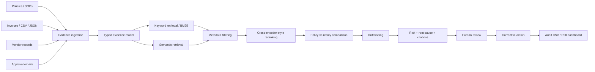

# OpsDrift AI

**OpsDrift AI is an India-focused procurement process-observability prototype.** It compares what a company policy says should happen with the evidence of what actually happened across vendor onboarding, purchase approvals, GST/TDS checks, invoice matching, and approval messages.

The project is intentionally different from a generic “chat with PDFs” application. It exposes the evidence chain, retrieval path, explicit business rules, process drift score, corrective action, evaluation metrics, and known limitations so that a finance or procurement operator can review and challenge the result.

**Public demo:** [https://opsdrift-ai.onrender.com](https://opsdrift-ai.onrender.com)
**GitHub:** [https://github.com/Anuradha390/opsdrift-ai](https://github.com/Anuradha390/opsdrift-ai)

---

## 1. Problem statement

Growing businesses often have a documented procurement process, but the actual work happens across spreadsheets, email threads, vendor exports, purchase requests, invoices, and approval messages. The gap between the official process and the real record is difficult to find manually.

OpsDrift AI focuses on that gap:

> Find repeated process deviations, show the evidence behind them, estimate the business impact, and create the next corrective action.

The demo uses Indian business examples and INR values, including GST/TDS checks, a ₹5,00,000 purchase threshold, vendor questionnaire controls, and PO–GRN–invoice matching.

---

## 2. What the prototype currently includes

### Procurement drift dashboard

- Process health score and procurement coverage
- Open drift findings with severity, process, evidence count, and impact
- Avoidable rework estimate and recovered actions
- Change monitoring when a policy threshold changes

### Evidence-grounded findings

Each finding shows:

- The policy requirement
- The observed business reality
- Business risk
- Likely root cause
- Recommended next action
- Source name, version, record/page reference, and excerpt
- Hybrid retrieval trail: keyword match, semantic match, metadata filter, and reranking score

### India controls workspace

- GST and TDS exception signals
- GST state mismatch review
- TDS threshold review
- PO → GRN → invoice three-way matching
- Vendor risk score and recurring flags
- Process drift scores by control area
- ROI summary in INR
- CSV audit-report export
- English/Hindi labels
- CSV/Excel-ready ingestion surface
- Integration-ready cards for Tally, Zoho Books, Gmail, and Outlook

### Evaluation lab

- BM25-only, vector-only, hybrid, and hybrid-plus-reranker comparison
- Recall@5 and MRR display
- Labelled question and query/passage-pair counts
- Explicit procurement and GST/TDS rulebook
- Known limitations and failure cases
- Human-review loop where a finding remains provisional until an operator confirms it

### Business toolkit

- CSV/JSON import preview with a column-mapping handoff point
- Editable workspace rulebook saved in the browser for the demo
- Searchable PO–GRN–invoice review queue with open, reviewing, and resolved states
- Vendor-risk explanations tied to visible flags rather than an unexplained score
- Policy-threshold simulator showing the estimated open-request impact
- Process drift heatmap by control owner
- Reviewer notes and CSV export for the review queue

### Interactive display controls

- Light, Dim, Dark, and System color themes
- Standard layout for normal work
- Compact layout for scanning more records at once
- Presentation layout for a clean full-width teacher or recruiter demo
- Selected theme and layout are remembered in the browser

---

## 3. Architecture



### Runtime architecture

```text
Browser / React UI
        |
        | local typed data + deterministic analysis for the MVP
        v
client/src/lib/opsdrift-data.ts
        |
        v
client/src/pages/Home.tsx
        |
        v
Vite frontend served through the Express application
        |
        v
server/_core/index.ts
        |
        +-- /api/health
        +-- static production files from dist/public
        +-- future tRPC / database integration boundary
```

The prototype keeps the analysis contract isolated in `client/src/lib/opsdrift-data.ts`. This makes it possible to replace the seeded data with real BM25, vector storage, embeddings, reranking, and database procedures later without redesigning the UI.

---

## 4. My contribution

I designed and implemented the procurement drift data model, evidence-grounded finding drawer, hybrid retrieval explanation layer, India-specific GST/TDS and three-way matching demo rules, vendor risk scoring, corrective-action flow, evaluation lab, human-review boundary, responsive React interface, Docker build, GitHub repository, and Render deployment.

The project deliberately documents what is implemented and what is not. Tally, Zoho Books, Gmail, Outlook, live GSTIN verification, authentication, and production vector infrastructure are documented as next steps rather than presented as connected features.

---

## 5. Sample data and reproducible test cases

The repository includes small, anonymised CSV files so the project can be reviewed as a data workflow rather than only as a visual mockup:

```text
sample-data/
  procurement-policy.csv
  purchase-orders.csv
  goods-receipts.csv
  invoices.csv
  vendors.csv
```

The files contain synthetic Indian procurement examples with INR amounts, GST states, TDS review flags, PO/GRN/invoice identifiers, vendor controls, and expected risk labels. They contain no real customer, employee, or vendor information.

Reproducible input/output scenarios are documented in [`docs/test-cases.md`](docs/test-cases.md). Project ownership, design decisions, and the evaluation disclaimer are in [`docs/project-notes.md`](docs/project-notes.md).

### Evaluation disclaimer

The current benchmark values are based on a small synthetic labelled dataset created for this prototype. They are not production accuracy claims and should not be used to make tax, payment, or vendor decisions without human review.

---

## 6. Project structure

```text
client/
  public/manus-routes.json       Declared browser route manifest
  src/pages/Home.tsx             Main dashboard, sections, drawers, and actions
  src/lib/opsdrift-data.ts       Seed data, rules, findings, benchmarks, and helpers
  src/index.css                  Dashboard visual system and responsive styles
sample-data/                     Anonymised CSV fixtures for procurement scenarios
docs/test-cases.md               Reproducible input/output review cases
docs/project-notes.md            Contribution, design, and evaluation notes
tests/opsdrift-data.test.ts      Automated checks for audit export and rule coverage
server/
  _core/index.ts                 Express entrypoint and health route
drizzle/                         Database foundation for a later persistence pass
Dockerfile                        Production container build
render.yaml                      Render Blueprint configuration
DEPLOY_RENDER.md                 Render deployment notes
plan.md                           Product plan and design decisions
TODO.md                           Delivered implementation outcomes
```

---

## 7. Prototype status

| Area | Status | Notes |
| --- | --- | --- |
| Dashboard and responsive UI | Implemented | Seeded procurement workspace is immediately explorable |
| Evidence drawer and citations | Implemented | Findings show requirement, reality, risk, root cause, and sources |
| Corrective actions | Implemented | Actions can be created and marked complete in the UI |
| Local text/CSV/JSON upload | Implemented | Files are added to the evidence library and analysed with deterministic rules |
| GST/TDS demo checks | Implemented as MVP rules | Uses seeded examples; no live government portal call |
| Three-way matching | Implemented as seeded/CSV-ready flow | Real ERP purchase-order APIs are not connected yet |
| Vendor risk | Implemented as demo scoring | Production scoring needs company history and feedback labels |
| Retrieval evaluation | Implemented as transparent demo lab | The displayed benchmark set is illustrative and must be replaced with a real labelled dataset |
| Business toolkit | Implemented as browser-local workflow prototype | Rule edits, review states, notes, and import preview are local until database persistence is connected |
| Database persistence | Foundation available | Dashboard state is currently client-side for the prototype |
| Authentication and roles | Not yet implemented | Required before handling real company documents |
| Live Tally/Zoho/Gmail/Outlook connectors | Not yet implemented | Integration-ready UI surfaces are included without pretending live access |

The project is a **functional prototype**, not a production compliance product. It is safe to demonstrate with synthetic or anonymised data.

---

## 8. Demo workflow

1. Open the live demo and start on **Operations overview**.
2. Read the main finding: three procurement checks failed in the current sample.
3. Select a finding to open the evidence drawer.
4. Compare the policy requirement with the observed record.
5. Expand the evidence chain and show the hybrid retrieval stages.
6. Create a corrective action or keep the finding under review.
7. Open **India controls** to show GST/TDS checks, three-way matching, vendor risk, process scores, and ROI.
8. Open **Evaluation lab** to show retrieval comparisons, labelled-set metadata, explicit rules, limitations, and the human-review boundary.
9. Open **Business toolkit** to demonstrate import preview, matching filters, reviewer status, rule editing, the policy simulator, vendor-risk explanations, and the drift heatmap.
10. Try the top-right **Standard**, **Compact**, and **Presentation** layout modes, then switch between Light, Dim, Dark, and System themes.
11. Download the audit CSV from the India controls workspace or export the review queue from Business toolkit.
12. Explain that the prototype is designed to be extended with real company documents and connectors, not presented as a live ERP integration.

### Suggested teacher explanation

> “This is not only a chatbot. I modelled procurement evidence, compared policy requirements with observed records, exposed the hybrid retrieval path, added explicit Indian procurement rules, measured retrieval baselines, documented limitations, and kept a human reviewer in the loop before an action is closed.”

---

## 9. Local development

### Requirements

- Node.js 22+
- pnpm 10+
- Git

### Install and run

```bash
git clone https://github.com/Anuradha390/opsdrift-ai.git
cd opsdrift-ai
pnpm install
pnpm dev
```

Use the public Render URL above when sharing the project with teachers, reviewers, or employers.

### Useful commands

```bash
pnpm check       # TypeScript validation
pnpm build       # Production frontend + server build
pnpm start       # Serve the production build
pnpm test        # Data-model and server tests
```

The deployed application health endpoint is [https://opsdrift-ai.onrender.com/api/health](https://opsdrift-ai.onrender.com/api/health) and returns `{"status":"ok"}` when the service is healthy.

Do not commit `.env` files, credentials, Render secrets, database URLs, or API keys. They are excluded through `.gitignore`.

---

## 10. Render deployment

The repository includes `render.yaml` and `Dockerfile`.

### Blueprint deployment

1. Open https://dashboard.render.com/.
2. Select **New → Blueprint**.
3. Choose the public repository `Anuradha390/opsdrift-ai`.
4. Select the `main` branch.
5. Keep the Blueprint path as `render.yaml`.
6. Create the Blueprint using the Free web-service plan for the demo.
7. Wait for the service status to become **Live**.

Render builds the Docker image, runs `pnpm install --frozen-lockfile`, runs `pnpm build`, starts `node dist/index.js`, and checks `/api/health`.

### Public deployment

Current public demo:

```text
https://opsdrift-ai.onrender.com
```

Health check:

```text
https://opsdrift-ai.onrender.com/api/health
```

Free Render services can sleep after inactivity. The first request after sleeping may take a few seconds while the service wakes up.

---

## 11. Known limitations and next engineering steps

- Replace seeded data with anonymised company documents and a labelled evaluation set.
- Add OCR for scanned PDF invoices and policies.
- Add database-backed evidence, users, roles, comments, and action history.
- Add authenticated GSTIN verification through an approved provider.
- Connect Tally, Zoho Books, Gmail, and Outlook through server-side connectors.
- Add production BM25 indexing, embeddings, vector storage, and a real cross-encoder reranker.
- Add audit-log immutability and access controls before processing confidential records.
- Add monitoring for false positives, missed findings, latency, and cost per analysis.

---

## 12. Resume-ready description

> Built **OpsDrift AI**, an India-focused procurement process-observability platform using React, Express, TypeScript, and a hybrid retrieval workflow. Compared policy requirements with invoice, vendor, approval, and purchase evidence; implemented GST/TDS checks, PO–GRN–invoice matching, vendor-risk scoring, corrective actions, audit export, retrieval benchmarks, and human-review controls. Deployed the Dockerised application to Render from a public GitHub repository.

### Short version

> India-focused procurement drift detection platform with hybrid retrieval, GST/TDS controls, three-way invoice matching, vendor risk scoring, evaluation benchmarks, and Render deployment.
